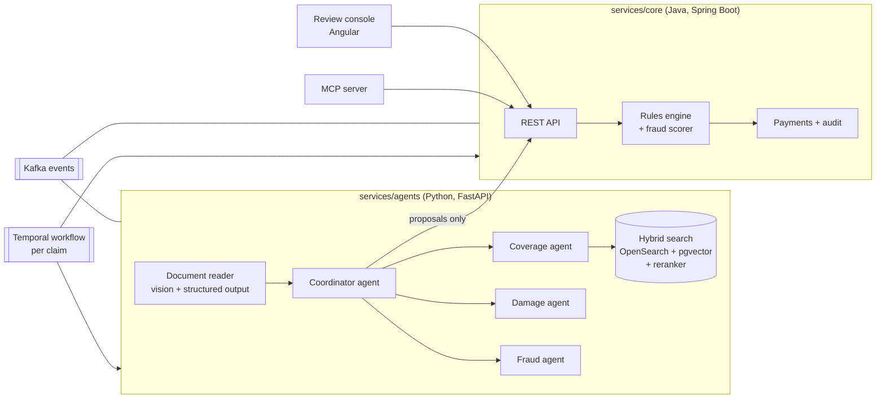

# Tramita

**An AI agent system that processes insurance claims end to end, where the model proposes and the
code decides.**

Tramita receives claims for a fictional Spanish insurer (*Aseguradora Brisa*), reads the attached
documents, checks what the policy covers with exact clause citations, checks that damages and
amounts add up, looks for fraud signals with concrete evidence, and proposes a resolution.
Deterministic rules in code decide whether that proposal can be executed automatically or must go
to a human claims handler, who approves, corrects or rejects it from a review console. Approved
payments are executed idempotently by the insurer's core system and every step is audited.

> Status: **Phase 11 (Kubernetes)** of 12 complete. See [PROGRESS.md](PROGRESS.md) for what is
> done and what is next. All data is synthetic; the insurer, its policies and its customers do not exist.

## Principles

1. **The model proposes, the code decides.** Models never write to the database or execute a
   payment. They propose actions through tools; the core service validates them against rules.
2. **Hard rules live in code, with tests**: coverage, limits, deductibles, notice periods, waiting
   periods and the threshold above which human review is mandatory.
3. **Fraud: the model finds signals, the code scores them.** Signals carry type, evidence and
   confidence; a deterministic, configurable scorer decides. No claim is rejected for fraud
   without a human.
4. **Citations are mandatory.** Every coverage statement cites a policy clause, or says that none
   applies.
5. **Personal data is masked** before it reaches any model, trace or log.
6. **Side effects are idempotent, gated by rules and audited.**
7. **Security from the first commit**: no secrets in code, secret scanning on every commit and in CI.
8. **Prompt-injection resistant**: document text is data, never instructions. The eval set includes
   documents with hidden instructions.

## Architecture (target)



The full design, with event flow and sequence diagrams, will live in
[docs/architecture.md](docs/architecture.md). Decisions and their trade-offs are recorded as ADRs
in [docs/decisions](docs/decisions).

## Stack

| Concern | Technology |
|---|---|
| Agents and orchestration | Python 3.12, FastAPI, official Anthropic SDK, Pydantic, uv |
| Core system and rules | Java 17, Spring Boot 3, Spring Data JPA, Flyway, PostgreSQL |
| Events | Apache Kafka (KRaft), transactional outbox over the audit trail, confluent-kafka consumers |
| Long-running processes | Temporal (Python SDK), one workflow per claim |
| Documents | S3 API (RustFS locally, see [ADR 0006](docs/decisions/0006-object-store-rustfs-instead-of-minio.md)) |
| Search | OpenSearch (BM25) + pgvector, reciprocal rank fusion, local embeddings and reranker (fastembed, ONNX) |
| Personal data | Microsoft Presidio (Spanish) |
| Review console | Angular 22, TypeScript, Vitest, Playwright, nginx |
| Tool access for analysts | MCP server (official Python SDK) |
| Observability | OpenTelemetry (GenAI semantic conventions), Micrometer, OTel Collector, Jaeger, Prometheus, Grafana |
| Infrastructure | Docker Compose, Helm + kind (network policies, hardened pods), GitHub Actions |

## Quick start

Requirements: Docker with Compose v2, [uv](https://docs.astral.sh/uv/), Java 17 and Maven 3.9+,
Node.js 22 for the console,
[Tesseract](https://tesseract-ocr.github.io/) with Spanish data (`apt install tesseract-ocr-spa`,
`brew install tesseract-lang`) for scanned documents, and
[gitleaks](https://github.com/gitleaks/gitleaks#installing) for the pre-commit hook.

```bash
make demo                 # everything below up to the agents' report, in one go and without credentials
make eval                 # every evaluation and the comparison with the baseline (after `make demo`)
```

Or step by step:

```bash
cp .env.example .env      # local-only placeholder values, including the core API keys
make up                   # start Postgres+pgvector, Kafka, OpenSearch, RustFS and Temporal
make smoke                # send every service a real request
make data                 # generate the synthetic dataset (seeded, a few seconds)
make core-run             # run the core service on :8080 (another terminal)
make seed                 # load the generated policies into the core
make ingest               # store, read (masked) and record every claim's documents in the core
make eval-extraction      # document reading accuracy, privacy and injection report
make index                # index the policy conditions (OpenSearch + pgvector; downloads ~1.2 GB of models once)
make eval-retrieval       # policy search report: lexical, vector, hybrid and reranked (a few minutes on CPU)
make process              # analyse every open claim with the agents and submit proposals to the core
make eval-agents          # end-to-end report: what the core decided against the expected resolutions
make scorecard            # every evaluation against the committed baseline (evals/baseline.json)
make obs-up               # Jaeger :16686, Prometheus :9090, Grafana :3000 (set the OTLP endpoints in .env)
make cost-report          # model calls, tokens, time and (when priced) dollars per claim and agent
make worker               # Temporal worker for the claim workflows (another terminal)
make bridge               # claim events on Kafka -> workflow signals (core with TRAMITA_EVENTS_ENABLED=true)
make start-claims         # one durable workflow per ingested claim
make console-up           # review console on http://localhost:4200 (core running on the host)
uv run tramita-mcp        # MCP server over stdio for an assistant (read-only analyst tools)
make test                 # Python and Java test suites (the Java integration tests need Docker)
make help                 # every available target
```

No Anthropic API key is needed: with `ANTHROPIC_API_KEY` empty, the agents use a deterministic fake
model that replays recorded answers or, for document reading, a labelled rule-based reader
([ADR 0005](docs/decisions/0005-run-without-an-api-key.md),
[ADR 0010](docs/decisions/0010-fake-model-recordings-then-rule-based-responders.md)). With a key
they use Claude (model ids in `.env`), and `TRAMITA_RECORD_MODEL=true` records the answers. The
policy search uses small local models (embeddings and a reranker on CPU), never an API.

Local endpoints after `make up`:

| Service | URL |
|---|---|
| PostgreSQL | `localhost:5432` |
| Kafka | `localhost:9092` |
| OpenSearch | http://localhost:9200 |
| S3 API / console | http://localhost:9000 / http://localhost:9001 |
| Temporal / UI | `localhost:7233` / http://localhost:8233 |

## Data

Everything is synthetic and reproducible from a seed (`make data`): seven products with Spanish
policy conditions rendered from one catalog, 200 policyholders, 150 claims with PDF and scanned
documents, and an expected resolution for each claim derived from the generated facts. See
[data/README.md](data/README.md) and [ADR 0007](docs/decisions/0007-synthetic-dataset-and-ground-truth.md).

## Document reading

`services/agents` reads invoices, estimates, police reports and accident reports, born-digital or
scanned, without any personal data reaching the model: PDFs are sent as masked text, and scans as
an image with personal data blacked out (located with Tesseract OCR) plus the masked OCR text.
The model fills a strict schema; code then checks formats and arithmetic and looks every value up
in a second reading to compute its confidence, and only facts above the review threshold reach
the rules. Text that tries to instruct the system is reported, never obeyed. See
[ADR 0011](docs/decisions/0011-reading-documents-with-masked-inputs.md).

Results on the 233 generated documents with the keyless rule-based reader (a baseline, not model
quality; `make eval-extraction`):

| Measure | Result |
|---|---|
| Classification | 100% |
| Key fields (number, date, CIF, total, rate; report dates) | 100% on PDFs and scans |
| Line items read exactly | all 131 PDFs; 37 of 39 scans (the other 2 go to review) |
| Wrong typed facts sent to the rules | 0 of 1,071 |
| Personal values reaching the model, the redacted scans or the core | 0 of 1,044 |
| Rule values lost to masking | 0 of 1,321 |
| Planted instructions found | 3 of 3 in PDFs, 0 of 3 in scans (too small for OCR), no false alarms |

## Policy search

The coverage agent can only cite what the search hands it, so `services/agents` searches the
Spanish policy conditions clause by clause, always within the policy's product: BM25 in
OpenSearch and local embeddings in pgvector, fused by reciprocal rank, then reordered by a local
cross-encoder. Queries are masked like documents before any model sees them, and every hit keeps
its rank at each stage. `POST /policy-search` exposes it. Models were chosen by measurement; see
[ADR 0012](docs/decisions/0012-hybrid-policy-search-measured.md).

Hit@5 (the answer among the five clauses an agent reads) on 432 queries (`make eval-retrieval`):

| Query set | BM25 | Vectors | Hybrid + reranker |
|---|---|---|---|
| Claim descriptions (72) | 51.4% | 87.5% | 91.7% |
| Everyday questions (295) | 53.9% | 95.6% | 90.2% |
| Keyword searches (65) | 100% | 72.3% | 100% |
| All | 60.4% | 90.7% | 91.9% (hit@1 73.6%) |

Each first stage has a blind spot; the reranked hybrid is the only option without one, at about
1.5 s per query on CPU. The queries are synthetic and written by the project's author, so these
numbers compare options rather than predict production accuracy.

## Kubernetes

A Helm chart (`deploy/helm/tramita`) runs the core, the agents, the review console and,
optionally, single-replica infrastructure with the same images as Compose. Pods run as non-root
with a read-only root file system and no capabilities, secrets are generated at install time,
and network policies deny ingress by default. `helm test` analyses a sample of claims inside the
cluster and checks that a pod with no role reaches only the console; CI runs it on kind. See
[ADR 0019](docs/decisions/0019-kubernetes-helm-chart-tested-in-kind.md).

```bash
kind create cluster --name tramita
deploy/helm/check-kind.sh        # build and load the images, install the chart, run helm test
```

## Observability and cost

Every claim is one OpenTelemetry trace across the agents and the core: the claim, each agent,
each model call with its model and tokens (GenAI semantic conventions), each tool call, each
search stage and the core's requests. Metrics cover model latency and tokens, stage durations,
routing and the rules' outcomes, and a provisioned Grafana dashboard shows them. Telemetry
carries identifiers, counts and timings, never text: CI processes the claims with telemetry on
and finds none of the ground truth's personal values in any span. `make cost-report` turns
tokens into dollars only for models whose price you configure. See
[ADR 0018](docs/decisions/0018-observability-genai-traces-without-content.md).

## Evaluation

Every quality claim in this README comes from an evaluation against ground truth derived from
the generated facts, and CI compares each headline number with a committed baseline: counts of
harm (personal data leaked, wrong facts sent to the rules, claims settled without the person
they needed, planted fraud settled automatically) must stay at zero, and scores may only drift
within a small tolerance. Today's baseline is keyless, so it measures the deterministic parts and
the baselines, not a model. End to end, without a key:

| Measure | Result |
|---|---|
| Decision correct, scored on the merits | 96.2% |
| Claims settled automatically that a person should have seen | 0 |
| Planted fraud to investigation / review / automatic | 12 / 6 / 0 of 18 |
| Decoys sent to investigation | 0 of 6 |
| Fraud score equal to the expected one | 96.0% |
| Personal values reaching a model, a redacted scan or the core | 0 of 1,044 |

See [ADR 0017](docs/decisions/0017-evaluation-baseline-and-scorecard.md).

## Agents

A coordinator written in code checks what needs no reading and asks three agents for the
judgements: the **coverage agent** searches the product's conditions and decides whether an
exclusion applies, the **damage agent** says which repair lines belong to the incident (code adds
them up), and the **fraud agent** reports signals whose quoted evidence must appear in the claim.
The core's rules then decide, compute and route. Agents can only make a claim safer: any of them,
and any document with embedded instructions, can ask for a person, and nothing they return can
skip a review. See [ADR 0013](docs/decisions/0013-agents-judge-code-coordinates-escalation-only.md).

End to end on the 150 claims without an API key (`make process && make eval-agents`), where the
agents are deterministic baselines that read nothing:

| Measure | Result |
|---|---|
| Decision correct, scored on the merits | 96.2% |
| Exclusions found / proposed wrongly | 10 of 14 / 0 |
| Rule violations | 1 |
| Settled automatically but should not be | **0** (10 before the baselines asked for review) |
| Routing as expected | 58.0%: without a model every payment goes to a person |

No real-model numbers yet: with `ANTHROPIC_API_KEY` set the same commands use Claude and the
report says so.

## MCP server for analysts

`tramita-mcp` gives an analyst's assistant read-only tools: search the policy conditions, list
claims, read a claim with its evaluation and citations, its audit trail and a queue overview.
It reads as ANALYST, so the core refuses any write, and every result is masked because a model
reads it. CI reads all 150 claims through it and finds none of the 1,650 personal values of the
ground truth. See [ADR 0016](docs/decisions/0016-read-only-mcp-for-analysts.md).

```json
{"mcpServers": {"tramita": {"command": "uv", "args": ["run", "--directory", "/path/to/tramita", "tramita-mcp"]}}}
```

## Review console

Claims handlers work in `web/console` (Angular): an inbox of what the rules sent to a person and,
for each claim, the facts, the rules' evaluation, the clauses cited with their text, the
documents as read, the fraud signals, why the agents asked for review and the audit trail, with a
form to approve, correct or reject. The browser never holds a credential: nginx serves the
console and adds the REVIEWER key on its way to the core, under a strict Content-Security-Policy.
CI approves a claim through the console in a real browser and expects it paid. See
[ADR 0015](docs/decisions/0015-review-console-behind-a-key-injecting-proxy.md).

## Events and workflows

Every state change in the core is written to its append-only audit trail in the same
transaction, and a relay publishes that trail, in order, to the Kafka topic
`tramita.claim-events`, keyed by claim, without personal data. One Temporal workflow per claim
analyses it, then waits for what it needs: missing documents (analysed again when they arrive) or
a claims handler's review (the final status read back), each with a deadline. A bridge turns the
events into workflow signals; consumers retry with backoff and park what still fails in a
dead-letter topic. CI runs the whole loop: a review approved through the API reaches the
workflow through Kafka and the claim ends paid. See
[ADR 0014](docs/decisions/0014-audit-trail-as-outbox-one-ordered-topic.md).

## Core system

`services/core` is the insurer's system of record and the place where decisions are made. Its
rules engine checks every proposal from the agents in a fixed order (policy in force, guarantee
included, waiting period, grounded exclusion, required documents, amounts, notice period, fraud
score, citations) and decides the routing. The code computes every payment; only consistent
payments up to 3,000 EUR and requests for required documents run without a person. API keys with
roles keep the agents from reviewing or paying, payments are unique per claim, and the audit trail
is append-only. The engine agrees with the dataset's independent reference resolver on all 150
claims. See [docs/architecture.md](docs/architecture.md),
[ADR 0008](docs/decisions/0008-deterministic-rules-and-fraud-scoring.md) and
[ADR 0009](docs/decisions/0009-api-keys-with-roles.md).

```bash
curl -s -H "X-Api-Key: analyst-change-me-local-only" localhost:8080/api/claims
```

## Contributing

```bash
pre-commit install        # secret scan and hygiene checks on every commit
```

Commits follow [Conventional Commits](https://www.conventionalcommits.org/), one per change. CI
scans the full history for secrets, lints, type-checks and tests every service, gates on the
document reading evaluation, starts the compose stack and sends each service a real request, runs
the core against it and ingests a sample of claims end to end, and builds every pushed commit on
its own so the history stays bisectable. Test counts are published as annotations.

## License

[MIT](LICENSE)

## Contact

[LinkedIn](https://www.linkedin.com/in/ignaciorodriguezcaro/)
