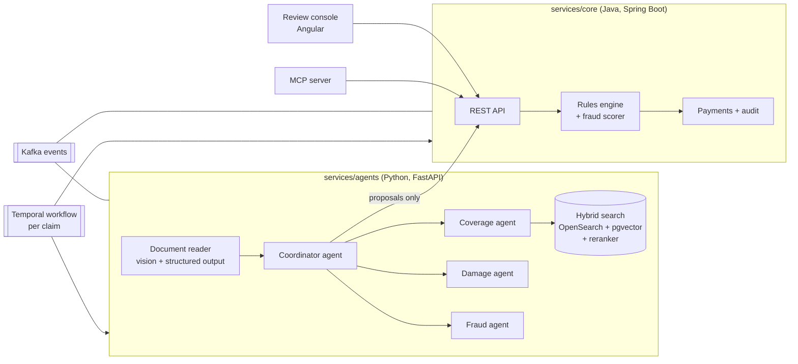

# Tramita

**An AI agent system that processes insurance claims end to end, where the model proposes and the
code decides.**

Tramita receives claims for a fictional Spanish insurer (*Aseguradora Brisa*), reads the attached
documents, checks what the policy covers with exact clause citations, checks that damages and
amounts add up, looks for fraud signals with concrete evidence, and proposes a resolution.
Deterministic rules in code decide whether that proposal can be executed automatically or must go
to a human claims handler, who approves, corrects or rejects it from a review console. Approved
payments are executed idempotently by the insurer's core system and every step is audited.

> Status: **Phase 1 (synthetic data)** of 12 complete. See [PROGRESS.md](PROGRESS.md) for what is done and
> what is next. All data is synthetic; the insurer, its policies and its customers do not exist.

## Principles

1. **The model proposes, the code decides.** Models never write to the database or execute a
   payment. They propose actions through tools; the core service validates them against rules.
2. **Hard rules live in code, with tests**: coverage, limits, deductibles, notice periods, waiting
   periods and the threshold above which human review is mandatory.
3. **Fraud: the model finds signals, the code scores them.** Signals carry type, evidence and
   confidence; a deterministic, configurable scorer decides. No claim is rejected for fraud
   without a human.
4. **Citations are mandatory.** Every coverage statement cites a policy clause, or says that none
   applies.
5. **Personal data is masked** before it reaches any model, trace or log.
6. **Side effects are idempotent, gated by rules and audited.**
7. **Security from the first commit**: no secrets in code, secret scanning on every commit and in CI.
8. **Prompt-injection resistant**: document text is data, never instructions. The eval set includes
   documents with hidden instructions.

## Architecture (target)



The full design, with event flow and sequence diagrams, will live in
[docs/architecture.md](docs/architecture.md). Decisions and their trade-offs are recorded as ADRs
in [docs/decisions](docs/decisions).

## Stack

| Concern | Technology |
|---|---|
| Agents and orchestration | Python 3.12, FastAPI, official Anthropic SDK, Pydantic, uv |
| Core system and rules | Java 17, Spring Boot 3, Spring Data JPA, Flyway, PostgreSQL |
| Events | Apache Kafka (KRaft) |
| Long-running processes | Temporal |
| Documents | S3 API (RustFS locally, see [ADR 0006](docs/decisions/0006-object-store-rustfs-instead-of-minio.md)) |
| Search | OpenSearch + pgvector + reranker, reciprocal rank fusion |
| Personal data | Microsoft Presidio (Spanish) |
| Review console | Angular, TypeScript |
| Tool access for analysts | MCP server (official Python SDK) |
| Observability | OpenTelemetry (GenAI semantic conventions), Tempo/Jaeger, Prometheus, Grafana |
| Infrastructure | Docker Compose, Helm + kind, GitHub Actions |

## Quick start

Requirements: Docker with Compose v2, [uv](https://docs.astral.sh/uv/), Java 17 and Maven 3.9+,
and [gitleaks](https://github.com/gitleaks/gitleaks#installing) for the pre-commit hook.

```bash
cp .env.example .env      # optional: every value has a local default
make up                   # start Postgres+pgvector, Kafka, OpenSearch, RustFS and Temporal
make test                 # Python and Java test suites
make help                 # every available target
```

No API key is needed: with `ANTHROPIC_API_KEY` empty, the system uses a deterministic fake model
with recorded responses ([ADR 0005](docs/decisions/0005-run-without-an-api-key.md)).

Local endpoints after `make up`:

| Service | URL |
|---|---|
| PostgreSQL | `localhost:5432` |
| Kafka | `localhost:9092` |
| OpenSearch | http://localhost:9200 |
| S3 API / console | http://localhost:9000 / http://localhost:9001 |
| Temporal / UI | `localhost:7233` / http://localhost:8233 |

## Data

Everything is synthetic and reproducible from a seed (`make data`): seven products with Spanish
policy conditions rendered from one catalog, 200 policyholders, 150 claims with PDF and scanned
documents, and an expected resolution for each claim derived from the generated facts. See
[data/README.md](data/README.md) and [ADR 0007](docs/decisions/0007-synthetic-dataset-and-ground-truth.md).

## Contributing

```bash
pre-commit install        # secret scan and hygiene checks on every commit
```

Commits follow [Conventional Commits](https://www.conventionalcommits.org/). CI runs the secret
scan, lint, type checks and tests of every service, and a smoke test of the compose stack.

## License

[MIT](LICENSE)
