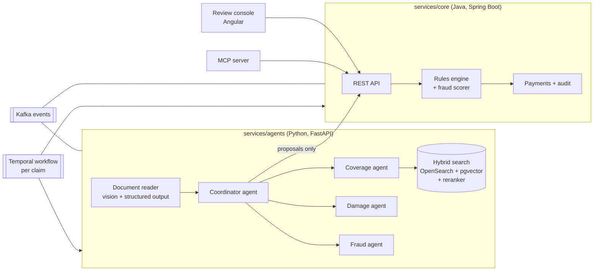

# Tramita

**An AI agent system that processes insurance claims end to end, where the model proposes and the
code decides.**

Tramita receives claims for a fictional Spanish insurer (*Aseguradora Brisa*), reads the attached
documents, checks what the policy covers with exact clause citations, checks that damages and
amounts add up, looks for fraud signals with concrete evidence, and proposes a resolution.
Deterministic rules in code decide whether that proposal can be executed automatically or must go
to a human claims handler, who approves, corrects or rejects it from a review console. Approved
payments are executed idempotently by the insurer's core system and every step is audited.

> Status: **Phase 3 (document reading)** of 12 complete. See [PROGRESS.md](PROGRESS.md) for what is
> done and what is next. All data is synthetic; the insurer, its policies and its customers do not exist.

## Principles

1. **The model proposes, the code decides.** Models never write to the database or execute a
   payment. They propose actions through tools; the core service validates them against rules.
2. **Hard rules live in code, with tests**: coverage, limits, deductibles, notice periods, waiting
   periods and the threshold above which human review is mandatory.
3. **Fraud: the model finds signals, the code scores them.** Signals carry type, evidence and
   confidence; a deterministic, configurable scorer decides. No claim is rejected for fraud
   without a human.
4. **Citations are mandatory.** Every coverage statement cites a policy clause, or says that none
   applies.
5. **Personal data is masked** before it reaches any model, trace or log.
6. **Side effects are idempotent, gated by rules and audited.**
7. **Security from the first commit**: no secrets in code, secret scanning on every commit and in CI.
8. **Prompt-injection resistant**: document text is data, never instructions. The eval set includes
   documents with hidden instructions.

## Architecture (target)



The full design, with event flow and sequence diagrams, will live in
[docs/architecture.md](docs/architecture.md). Decisions and their trade-offs are recorded as ADRs
in [docs/decisions](docs/decisions).

## Stack

| Concern | Technology |
|---|---|
| Agents and orchestration | Python 3.12, FastAPI, official Anthropic SDK, Pydantic, uv |
| Core system and rules | Java 17, Spring Boot 3, Spring Data JPA, Flyway, PostgreSQL |
| Events | Apache Kafka (KRaft) |
| Long-running processes | Temporal |
| Documents | S3 API (RustFS locally, see [ADR 0006](docs/decisions/0006-object-store-rustfs-instead-of-minio.md)) |
| Search | OpenSearch + pgvector + reranker, reciprocal rank fusion |
| Personal data | Microsoft Presidio (Spanish) |
| Review console | Angular, TypeScript |
| Tool access for analysts | MCP server (official Python SDK) |
| Observability | OpenTelemetry (GenAI semantic conventions), Tempo/Jaeger, Prometheus, Grafana |
| Infrastructure | Docker Compose, Helm + kind, GitHub Actions |

## Quick start

Requirements: Docker with Compose v2, [uv](https://docs.astral.sh/uv/), Java 17 and Maven 3.9+,
[Tesseract](https://tesseract-ocr.github.io/) with Spanish data (`apt install tesseract-ocr-spa`,
`brew install tesseract-lang`) for scanned documents, and
[gitleaks](https://github.com/gitleaks/gitleaks#installing) for the pre-commit hook.

```bash
cp .env.example .env      # local-only placeholder values, including the core API keys
make up                   # start Postgres+pgvector, Kafka, OpenSearch, RustFS and Temporal
make smoke                # send every service a real request
make data                 # generate the synthetic dataset (seeded, a few seconds)
make core-run             # run the core service on :8080 (another terminal)
make seed                 # load the generated policies into the core
make ingest               # store, read (masked) and record every claim's documents in the core
make eval-extraction      # document reading accuracy, privacy and injection report
make test                 # Python and Java test suites (the Java integration tests need Docker)
make help                 # every available target
```

No Anthropic API key is needed: with `ANTHROPIC_API_KEY` empty, the agents use a deterministic fake
model that replays recorded answers or, for document reading, a labelled rule-based reader
([ADR 0005](docs/decisions/0005-run-without-an-api-key.md),
[ADR 0010](docs/decisions/0010-fake-model-recordings-then-rule-based-responders.md)). With a key
they use Claude (model ids in `.env`), and `TRAMITA_RECORD_MODEL=true` records the answers.

Local endpoints after `make up`:

| Service | URL |
|---|---|
| PostgreSQL | `localhost:5432` |
| Kafka | `localhost:9092` |
| OpenSearch | http://localhost:9200 |
| S3 API / console | http://localhost:9000 / http://localhost:9001 |
| Temporal / UI | `localhost:7233` / http://localhost:8233 |

## Data

Everything is synthetic and reproducible from a seed (`make data`): seven products with Spanish
policy conditions rendered from one catalog, 200 policyholders, 150 claims with PDF and scanned
documents, and an expected resolution for each claim derived from the generated facts. See
[data/README.md](data/README.md) and [ADR 0007](docs/decisions/0007-synthetic-dataset-and-ground-truth.md).

## Document reading

`services/agents` reads invoices, estimates, police reports and accident reports, born-digital or
scanned, without any personal data reaching the model: PDFs are sent as masked text, and scans as
an image with personal data blacked out (located with Tesseract OCR) plus the masked OCR text.
The model fills a strict schema; code then checks formats and arithmetic and looks every value up
in a second reading to compute its confidence, and only facts above the review threshold reach
the rules. Text that tries to instruct the system is reported, never obeyed. See
[ADR 0011](docs/decisions/0011-reading-documents-with-masked-inputs.md).

Results on the 233 generated documents with the keyless rule-based reader (a baseline, not model
quality; `make eval-extraction`):

| Measure | Result |
|---|---|
| Classification | 100% |
| Key fields (number, date, CIF, total, rate; report dates) | 100% on PDFs and scans |
| Line items read exactly | all 131 PDFs; 37 of 39 scans (the other 2 go to review) |
| Wrong typed facts sent to the rules | 0 of 1,071 |
| Personal values reaching the model, the redacted scans or the core | 0 of 1,044 |
| Rule values lost to masking | 0 of 1,321 |
| Planted instructions found | 3 of 3 in PDFs, 0 of 3 in scans (too small for OCR), no false alarms |

## Core system

`services/core` is the insurer's system of record and the place where decisions are made. Its
rules engine checks every proposal from the agents in a fixed order (policy in force, guarantee
included, waiting period, grounded exclusion, required documents, amounts, notice period, fraud
score, citations) and decides the routing. The code computes every payment; only consistent
payments up to 3,000 EUR and requests for required documents run without a person. API keys with
roles keep the agents from reviewing or paying, payments are unique per claim, and the audit trail
is append-only. The engine agrees with the dataset's independent reference resolver on all 150
claims. See [docs/architecture.md](docs/architecture.md),
[ADR 0008](docs/decisions/0008-deterministic-rules-and-fraud-scoring.md) and
[ADR 0009](docs/decisions/0009-api-keys-with-roles.md).

```bash
curl -s -H "X-Api-Key: analyst-change-me-local-only" localhost:8080/api/claims
```

## Contributing

```bash
pre-commit install        # secret scan and hygiene checks on every commit
```

Commits follow [Conventional Commits](https://www.conventionalcommits.org/), one per change. CI
scans the full history for secrets, lints, type-checks and tests every service, gates on the
document reading evaluation, starts the compose stack and sends each service a real request, runs
the core against it and ingests a sample of claims end to end, and builds every pushed commit on
its own so the history stays bisectable. Test counts are published as annotations.

## License

[MIT](LICENSE)

## Contact

[LinkedIn](https://www.linkedin.com/in/ignaciorodriguezcaro/)
