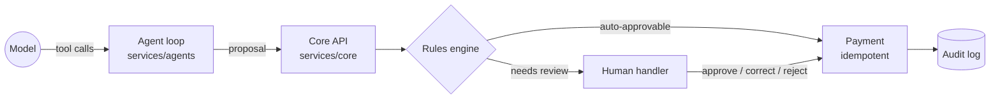
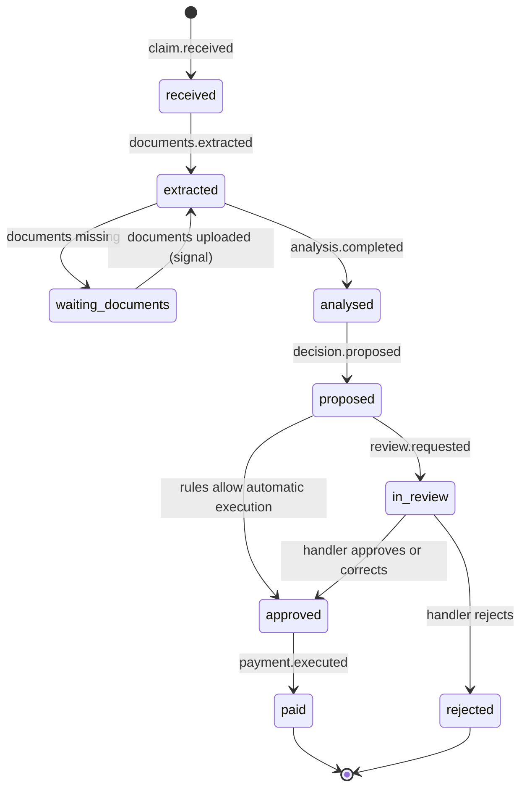

# Architecture

This document grows with the project. Sections marked *planned* describe the target design that
later phases implement; everything else describes the code as it is.

## Components

| Component | Path | Responsibility |
|---|---|---|
| Agent service | `services/agents` | Document reading, policy search, agents, Kafka consumers, Temporal workflows |
| Core service | `services/core` | System of record: policies, claims, rules engine, fraud scoring, payments, audit |
| MCP server | `services/mcp` | Analyst tools over the core API, guarded by the same rules (*planned*) |
| Review console | `web/console` | Claims handler inbox, claim detail, approve / correct / reject (*planned*) |
| Data generator | `data/generator` | Reproducible synthetic policies, policyholders, claims and documents (*planned*) |
| Evals | `evals` | Eval set, runner, reports and baseline with a CI gate (*planned*) |

## Trust boundary

The language boundary is the trust boundary ([ADR 0002](decisions/0002-python-for-agents-java-for-core.md)).
The agent service holds no database credentials for the core schema and cannot execute payments.
It submits *proposals*; the core validates every proposal against rules written and tested in Java.

## Claim lifecycle (*planned*)

Kafka carries the public record of facts; Temporal drives each claim's lifecycle
([ADR 0004](decisions/0004-kafka-choreography-temporal-orchestration.md)).

## Local infrastructure

`make up` starts the stack in [deploy/compose/docker-compose.yml](../deploy/compose/docker-compose.yml)
and waits until every health check passes.

| Service | Image | Purpose |
|---|---|---|
| postgres | `pgvector/pgvector:0.8.7-pg17-trixie` | Core data, pgvector embeddings, Temporal persistence |
| kafka | `apache/kafka:4.2.2` | Domain events, KRaft mode, no topic auto-creation |
| opensearch | `opensearchproject/opensearch:3.9.0` | Full-text search over policy clauses |
| object-store | `rustfs/rustfs:1.0.3` | S3-compatible storage for claim documents |
| temporal | `temporalio/auto-setup:1.29.7` | Durable per-claim workflows |
| temporal-ui | `temporalio/ui:2.56.0` | Workflow inspection |
