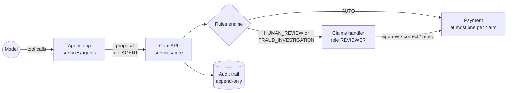
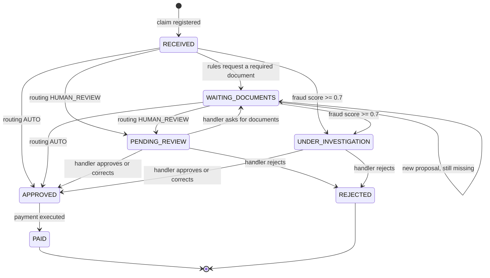
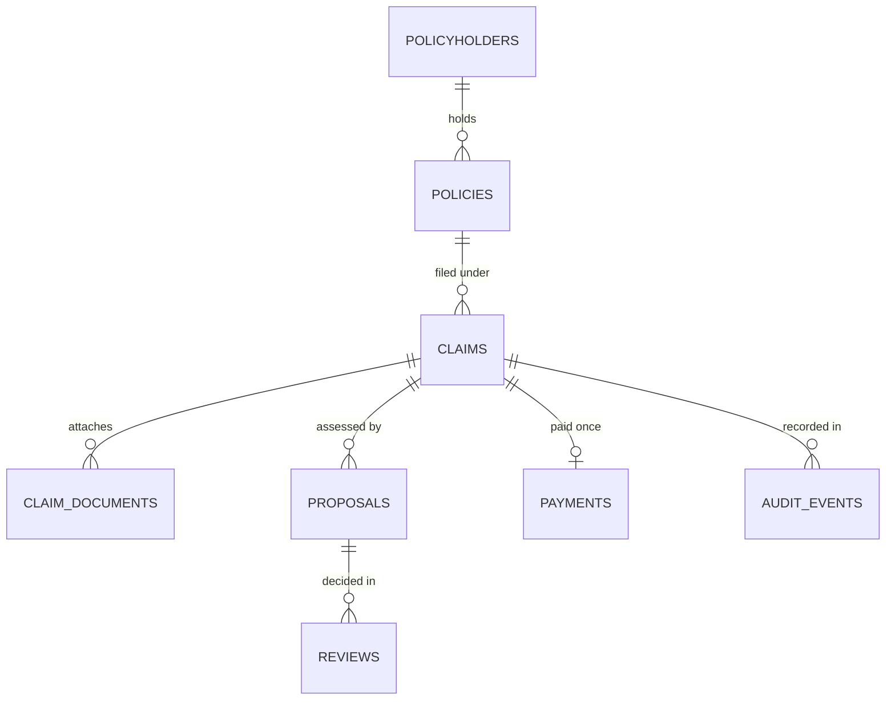

# Architecture

This document grows with the project. Sections marked *planned* describe the target design that
later phases implement; everything else describes the code as it is.

## Components

| Component | Path | Responsibility |
|---|---|---|
| Core service | `services/core` | System of record: policies, claims, rules engine, fraud scoring, payments, audit |
| Data generator | `data/generator` | Reproducible synthetic policies, policyholders, claims, documents and expected resolutions |
| Agent service | `services/agents` | Document reading, policy search, agents, Kafka consumers, Temporal workflows (*skeleton*) |
| MCP server | `services/mcp` | Analyst tools over the core API, guarded by the same rules (*planned*) |
| Review console | `web/console` | Claims handler inbox, claim detail, approve / correct / reject (*planned*) |
| Evals | `evals` | Eval set, runner, reports and baseline with a CI gate (*planned*) |

## Trust boundary

The language boundary is the trust boundary ([ADR 0002](decisions/0002-python-for-agents-java-for-core.md)),
and API roles enforce it ([ADR 0009](decisions/0009-api-keys-with-roles.md)). The agent service
authenticates as `AGENT`: it can register claims, attach documents and extractions and submit
*proposals*, but it cannot review or pay. The core checks every proposal with a pure rules engine
([ADR 0008](decisions/0008-deterministic-rules-and-fraud-scoring.md)).

## Rules engine

`dev.tramita.core.rules.RulesEngine` is a pure function of the policy facts, the claim facts (from
the claim form, the extracted documents and earlier claims) and the proposal. It runs these checks
in order; the first three decide regardless of the proposal:

| # | Check | Outcome when it applies |
|---|---|---|
| 1 | Incident within the policy period | Reject, `POLICY_NOT_IN_FORCE` |
| 2 | Guarantee included in the product | Reject, `NOT_INCLUDED`, must cite the "not included" clause |
| 3 | Outside the waiting period | Reject, `WAITING_PERIOD`, must cite the waiting-period clause |
| 4 | A proposed rejection relies on a catalog exclusion of that guarantee | Reject, `EXCLUSION`; otherwise violation `UNGROUNDED_REJECTION` |
| 5 | Required documents received | Request them, `MISSING_DOCUMENTS` (automatic) |
| 6 | Amounts | Pay `min(eligible, limit) - deductible`; eligible never above the documented lines plus tax |
| 7 | Notice within 7 days | Otherwise `LATE_NOTICE`: human review, cover unchanged |
| 8 | Fraud score from rule and model signals | 0.4 review, 0.7 investigation |
| 9 | Citations exist, belong to the product and include the grounding clause | Otherwise a violation |
| 10 | Routing | `AUTO` only for consistent payments up to 3,000 EUR and requests for required documents |

## Claim lifecycle

Implemented in the core (`ClaimStatus`). Events and workflows around it are *planned*: Kafka will
carry the public record of facts and Temporal will drive each claim
([ADR 0004](decisions/0004-kafka-choreography-temporal-orchestration.md)).

Documents and extractions can change only in `RECEIVED` and `WAITING_DOCUMENTS`, so a handler
always reviews the evidence the rules checked. `PAID` and `REJECTED` are final.

## Data model

Schema `core`, migrated by Flyway (`services/core/src/main/resources/db/migration`).

- `proposals` stores the agents' proposal next to the full rules evaluation (JSON) and the
  decision, amount and routing the rules allowed.
- `payments.claim_id` is unique: a claim can be paid once, whatever retries or races happen.
- `audit_events` is append-only: a trigger rejects updates and deletes.
- Extracted document facts keep personal data masked; amounts, dates and invoice identifiers are
  stored in typed columns for the rules and for duplicate-invoice detection.

## Core API

JSON in snake_case. Errors are RFC 9457 problem details that name the offending field. Endpoints
that change state are idempotent: claims and documents by id, proposals and reviews by the
`Idempotency-Key` header.

| Method and path | Role | Purpose |
|---|---|---|
| `POST /api/import/policies` | ADMIN | Upsert policyholders and policies (generator format) |
| `POST /api/claims` | AGENT | Register a claim |
| `POST /api/claims/{id}/documents` | AGENT | Attach a document (file in the object store) |
| `PUT /api/claims/{id}/documents/{doc}/extraction` | AGENT | Record extracted, masked facts |
| `POST /api/claims/{id}/proposals` | AGENT | Submit a proposal; returns the rules evaluation, new status and any payment |
| `POST /api/claims/{id}/reviews` | REVIEWER | Approve, correct (within the guarantee limit) or reject |
| `GET /api/claims?status=...` | any | Inbox, default pending review and under investigation |
| `GET /api/claims/{id}` | any | Claim with documents, proposals, reviews and payment |
| `GET /api/claims/{id}/audit` | any | Audit trail |
| `GET /api/policies/{n}` and `/api/policies/{n}/claims` | any | Policy (holder reduced to id and city) and its claims |

## Local infrastructure

`make up` starts the stack in [deploy/compose/docker-compose.yml](../deploy/compose/docker-compose.yml)
and waits until every health check passes; `make smoke` then sends each service a real request.

| Service | Image | Purpose |
|---|---|---|
| postgres | `pgvector/pgvector:0.8.7-pg17-trixie` | Core data, pgvector embeddings, Temporal persistence |
| kafka | `apache/kafka:4.2.2` | Domain events, KRaft mode, no topic auto-creation |
| opensearch | `opensearchproject/opensearch:3.9.0` | Full-text search over policy clauses |
| object-store | `rustfs/rustfs:1.0.3` | S3-compatible storage for claim documents |
| temporal | `temporalio/auto-setup:1.29.7` | Durable per-claim workflows |
| temporal-ui | `temporalio/ui:2.56.0` | Workflow inspection |

## Continuous integration

Every push runs: a secret scan of the full history; Python lint, strict types and tests; the Java
build with unit, integration (Testcontainers PostgreSQL) and cross-check tests; the compose stack
with its smoke test; and a build of every pushed commit on its own. Test counts are published as
annotations, and releases are created from `docs/releases/*.md`.
